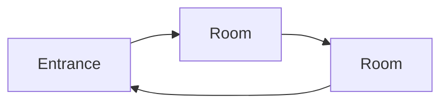

See [[Dungeon Design]] for the method and [[Encounter Tables]] for the table.

**In a sentence.**

**Themes and aspects.** aspect, aspect, aspect. These set the tone and the denizens.

## Brainstorm

Long and rambly, no structure. Everything that lives here and anything that might need lore. Cut it down in the next section.

-
## Simplify

### History

**Built by.** Who made it and why.

**Later occupants.** Who came after, and what they think it is.

**Situation now.** What the party walks into.

### Factions inside

Who lives here, who is in charge, and what each group wants. Note who would help the party and who would not.

**[[Faction]].**

**[[Faction]].**

## Ways in

**The denizens' way.** How the residents come and go.

**Hidden.** Back doors, old passages, ways the residents have forgotten.

**Unintended.** Ways nobody planned for: rivers, chimneys, collapses, the toilet.

## Needs

Tick each once a room covers it.

- [ ] Food and drink: where it is grown, stored, cooked and eaten
- [ ] Environment: staying warm, cool, dry, lit
- [ ] Sleep
- [ ] Work
- [ ] Rest and leisure
- [ ] Plot areas: ritual chambers, treasure rooms, traps

## Levels

Skip this for a single-level dungeon.

1. **Name.**
2. **Name.**
3. **Name.**

## Rooms

A quick description of each. No encounters yet; those come from the table.

### Room name
*Description.* What it is for and who uses it.
*What it shows.* Sights, sounds and smells; murals, carvings, writing. This is how the history gets across.
*Connects to.*

### Room name
*Description.*
*What it shows.*
*Connects to.*

### Room name
*Description.*
*What it shows.*
*Connects to.*

## Map

Aim for a graph with loops, so there is more than one way between any two places.

### Denizen routines

Paths a resident takes through the day, e.g. farm → pens → storeroom → kitchen → mess hall → bedrooms.

-

## Strange things

Odd objects and features that can go in any room.

-

## Secrets and clues

Each clue lives in a room. Show it, never tell it: no monologues, no lore dumps.

| Secret | Where it shows | Found |
|---|---|---|
|  |  | [ ] |
|  |  | [ ] |
|  |  | [ ] |

## Key monsters

**Name.** Level, role. Inspiration and Vibe

## Alertness

How the dungeon reacts once the party is noticed. What changes at each level.

| Level | Trigger | What changes |
|---|---|---|
| Unaware |  |  |
| Suspicious |  |  |
| Alert |  |  |
| Lockdown |  |  |

## Tables

### Encounters (2d6)

2 is the biggest threat, 12 is a powerful figure who might help. 3–6 come from the dungeon's main threat, 8–11 from the area, and 7 is hunting the party.

| Roll | Slot | Encounter |
|---|---|---|
| 2 | The dragon |  |
| 3 | Runner-up or lieutenant |  |
| 4 | Horde of the dragon's minions |  |
| 5 | Construct or abomination |  |
| 6 | Hunter of the dragon, dangerous but not hostile |  |
| 7 | The dragon's elite, hunting the party |  |
| 8 | Hunter from a backstory, or a known NPC |  |
| 9 | Area monstrosity or experiment |  |
| 10 | Area horde |  |
| 11 | Area champion |  |
| 12 | The wizard |  |

### Treasure and environment (2d6)

| Roll | Slot | Find |
|---|---|---|
| 2 | Faction specific (legendary) |  |
| 3–6 | Faction specific (good) |  |
| 7 | Former adventurer's gear |  |
| 8–11 | Faction specific (poor) |  |
| 12 | No gear |  |

